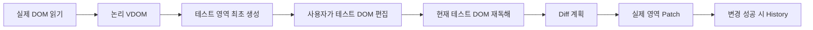
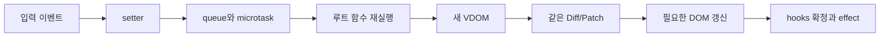

# API Studio 코드 학습 설명서와 README 발표 준비

작성일: **2026-11-08 (Asia/Seoul)**  
설명 기준 HEAD: **885d8ea1d7ff2d9560c1cf4e73eff77205339bfa**  
제품 코드 SHA: **e513ba404d00cfbf3602afe240276efa2920905e**

이 문서는 개인 구현을 이해하기 위한 학습 자료다. 팀 저장소 병합·팀 통합 검증·발표 리허설을 수행했다는 의미는 아니다. 제품 코드, 시험, README와 검수 판정은 수정하지 않았다.

최신 [TURN12 첫 수정 후 독립 검수](loop/reviews/turn12.md#L103)는 **PASS / APPROVED**, Phase 2는 **구현됨 / 독립 검증 완료**, QA12-001은 독립 RESOLVED다. 이 보고는 현재 작업 트리에 미커밋 상태로 존재한다. HEAD만 checkout하면 최신 보고가 빠질 수 있으므로 인계 파일도 함께 보존해야 한다. README 첫 문장과 마지막 절의 “독립 재검수 대기”는 이전 상태다. 이 설명서는 최신 검수 원문을 기준으로 안내하며 README는 변경하지 않는다.

## 사용법

- 처음 공부할 때: **A 전체 지도 → B2 초기 복제 → B3 Diff → B4 Patch → C2 useState → D 사용자 동작** 순서로 읽는다.
- 코드 리뷰 준비: 각 절의 **반드시 읽기 / 시험 근거**를 소스와 나란히 본다.
- 발표 직전: **F 대본 → G 예상 질문 → 실습 답안**만 복습한다.
- **코드 발췌**는 실제 파일의 지정 줄 그대로다. **학습용 예시**는 작은 설명용 입력이며 앱에 그 예제 기능이 있다는 뜻은 아니다. `… 생략 …`은 발췌 사이의 생략이다.
- 링크는 이 문서 위치 기준 상대 경로이며 `#L숫자`는 기준 소스의 줄 번호다. 로컬 뷰어가 줄 이동을 지원하지 않으면 파일을 열어 해당 줄로 이동한다. 이후 코드 변경 시 위치를 다시 확인한다.
- 검증 수치는 이미 존재하는 최신 독립 보고·로그를 확인해 인용했다. **이번 문서 작성에서 테스트를 새로 실행하지 않았다.**

## A. 먼저 읽는 전체 지도

### A1. 무엇을 만들었나

**Mini React**는 현재 화면과 다음 화면을 객체로 표현하고 비교해 실제 DOM을 바꾸는 자체 엔진이다. **DOM Lab**은 엔진과 History를 검증하는 Phase 1 화면이다. **API Studio**는 같은 엔진 위에서 요청 편집·Fetch·응답 분석을 제공하는 Phase 2 앱이다.

Phase 1은 사용자가 편집한 DOM에서 다음 화면 데이터를 얻고, Phase 2는 루트 함수가 반환한 VDOM에서 얻는다. 출처는 다르고 반영하는 renderer/Diff/Patch는 같다.



원본 source Node는 유지한다. form 소유권·물리 ID 격리는 native 관계 보존을 위한 경계 보정이며 전체 재생성이 아니다. no-op이면 새 History는 저장하지 않는다.



### A2. 언어와 실행 환경

| 구분 | 실제 역할 | 확인할 코드 |
|---|---|---|
| TypeScript | 제품 원본21개, strict TypeScript7.0.2. VDOM·Hook·HTTP 타입 경계 | [types.ts:1](../src/mini-react/types.ts#L1), [tsconfig:2](../tsconfig.json#L2) |
| JavaScript | tsc가 만든 `dist/src/*.js` 브라우저 native ES modules | [build.js:13](../scripts/build.js#L13) |
| Node.js | 정적 개발 서버·빌드·Vitest/Playwright·HTTP/CORS fixture | [server.js:4](../scripts/server.js#L4), [package.json:6](../package.json#L6) |
| 제품 API 서버 | 별도 없음. 브라우저 Fetch가 지정한 대상 API에 요청 | [sendRequest:32](../src/api/request.ts#L32) |

`npm run dev`는 초기 build 후 dist를 서빙한다. 두 화면은 `/`와 `/phase1/`다. watch는 없으므로 소스 수정 후 build+reload한다. TS 내부 `import './renderer.js'`는 생성물 URL이며 컴파일러는 대응 `renderer.ts`를 해석한다. unit JS 시험은 TS 원본을 import한다.

외부 UI 프레임워크가 없다는 근거는 [package.json:14](../package.json#L14)에 도구만 devDependencies로 있고 런타임 dependencies가 없으며, [main.ts:1](../src/main.ts#L1)에서 자체 FunctionComponent와 renderer로 연결된다는 점이다. 패키지 목록과 실제 import를 함께 본다.

### A3. 파일별 역할과 추천 읽기 순서

| 순서 | 파일·함수와 기준 줄 | 읽을 이유 |
|---|---|---|
| 1 | [types.ts:5](../src/mini-react/types.ts#L5) VNode/Tree | 화면 데이터의 공통 언어 |
| 2 | [vnode.ts:33](../src/mini-react/vnode.ts#L33) h, [dom.ts:45](../src/mini-react/dom.ts#L45) domToVNode | 데이터 생성과 실제 DOM 읽기 |
| 3 | [controller.ts:9](../src/phase1/controller.ts#L9) createPhase1 | Phase 1 전체 흐름 |
| 4 | [diff.ts:32](../src/mini-react/diff.ts#L32) diff/reconcile | 다음 구조를 명령으로 표현 |
| 5 | [patch.ts:7](../src/mini-react/patch.ts#L7) validatePatch, patch:31 | 참조 결속·검증·실행 |
| 6 | [renderer.ts:5](../src/mini-react/renderer.ts#L5) createRenderer | committedTree와 계획 수명 |
| 7 | [phase1/history.ts:4](../src/phase1/history.ts#L4) createHistory | snapshot·cursor·분기 |
| 8 | [component.ts:61](../src/mini-react/component.ts#L61) update | 상태→화면 중심 경로 |
| 9 | [hooks.ts:12](../src/mini-react/hooks.ts#L12) renderWithHooks, useSlot:22 | 순서로 상태를 다시 찾는 원리 |
| 10 | [hooks.ts:31](../src/mini-react/hooks.ts#L31) useState, useMemo:47, useEffect:54 | 세 Hook의 책임과 시점 |
| 11 | [App.ts:12](../src/App.ts#L12) App | 실제 서비스 루트 |
| 12 | [panels.ts:39](../src/components/panels.ts#L39) KeyValueRows, RequestEditor:50 | 이벤트와 props 전용 자식 |
| 13 | [request.ts:5](../src/api/request.ts#L5), [response.ts:4](../src/api/response.ts#L4), [api/history.ts:4](../src/api/history.ts#L4) | HTTP·외부 데이터·개인정보 |
| 심화 | [scope.ts:8](../src/mini-react/scope.ts#L8), [boundaries.ts:4](../src/phase1/boundaries.ts#L4), [ID 설명](id-scope.md) | ID 연결과 radio 격리 |

필수 중심은 DOM↔VDOM, 다섯 변화, Diff/Patch·Node 재사용, History/Undo/Redo, FunctionComponent·세 Hook, 루트 상태/순수 자식, 공유 엔진, REST UI다. 취소·timeout·늦은 응답 방어, 물리 ID 격리, 이력 정제, Viewer 제한은 안정성 보강이다. 모두 현재 구현 계약이지만 원 과제에서 각각 별도 필수였다고 소개하지 않는다. TypeScript는 사용자 추가 승인에 따른 언어 변경이다.

## B. Phase 1 코드 학습

### B1. VNode와 Tree: 비교할 데이터 모양

**1. 해결할 문제.** DOM의 구조와 live 값, listener를 일관된 데이터로 표현해야 다음 화면과 비교할 수 있다.

**2. 쉬운 예시.** `<p class="greet">Hi</p>`를 “element p, class greet, 자식 text Hi”로 적는다. 설계도라는 비유이며 Node나 픽셀을 복사한다는 뜻은 아니다.

**3~4. 실제 위치와 입출력.** [types.ts:5](../src/mini-react/types.ts#L5)의 VNode는 element/text/comment union이다. Tree는 고정 host의 **자식들**을 감싸는 가상 root다. host 자체는 교체 대상이 아니다.

학습용 예시 — 정규화된 데이터의 일부:

```ts
const example = {
  kind: 'root',
  children: [{
    kind: 'element', tag: 'p', key: null,
    attrs: { class: 'greet' }, props: {}, events: {},
    children: [{ kind: 'text', text: 'Hi' }]
  }]
};
```

| 필드 | 담는 것 | 분리하는 이유 |
|---|---|---|
| attrs | HTML content attribute, class/id/style 문자열 | getAttribute와 비교할 선언 |
| props | value/checked/selected의 live 제어 목표 | 사용자의 현재 입력은 attribute와 다를 수 있음 |
| events | 이벤트 종류→함수 | HTML 문자열에서 listener를 복원할 수 없음 |
| key | 형제 내 정체성 | 순서 변화 뒤 대응 Node를 찾기 위함 |

text input의 `getAttribute('value')`와 사용자가 바꾼 `input.value`는 다를 수 있다. 단 checkbox/radio value와 type 전환은 content attribute에 영향을 줄 수도 있다. [dom.ts:8](../src/mini-react/dom.ts#L8)의 WeakMap은 엔진이 쓴 정확한 논리/물리 value를 기록한다. “attrs는 언제나 초기값으로 고정”이라고 외우면 틀린다.

**5. 반드시 읽기.** [h:33](../src/mini-react/vnode.ts#L33)는 children 평탄화·숫자 text 변환·null/boolean 생략을 한다. 공백·빈 text·comment는 보존한다. [validateVNode:66](../src/mini-react/vnode.ts#L66)은 런타임 입력을 검사한다.

**6. 시험 근거.** [vdom.test.js:6](../tests/unit/vdom.test.js#L6)의 literal 구조, 16줄 정규화, 22줄 live form 값.

**7. 발표 문장.** “구조·속성·현재 입력값·이벤트를 나눈 객체를 만들어 같은 기준으로 화면을 비교했습니다.”

### B2. DOM↔VDOM, 최초 복제와 현재 DOM 재독해

**1. 문제.** 사용자 편집은 실제 테스트 DOM에서 일어난다. 과거 문자열 초안만 비교하면 최신 편집을 놓친다.

**2. 예시.** 원본 제목 A를 테스트 영역에서만 B로 바꿨다면 Patch 시점의 B Node를 읽어야 한다.

**3~4. 위치와 흐름.** [domToVNode:45](../src/mini-react/dom.ts#L45)는 Node→VNode, [readTree:58](../src/mini-react/dom.ts#L58)는 childNodes→Tree, [createDOM:59](../src/mini-react/dom.ts#L59)는 VNode→detached Node다. 생성 시 자식을 만든 뒤 props와 events를 적용한다. DOM을 읽어 addEventListener를 역추출할 수 없어 events는 빈 객체다. 앱의 엔진 소유 events는 committedTree에 남는다.

[createPhase1:9](../src/phase1/controller.ts#L9)의 초기화는 원본 읽기→안전 정책→scope/form 경계→원본 renderer→빈 editor render→S0 저장이다. 실제 source Node는 `===`로 유지한다. id/for/ARIA IDREF만 native 연결을 위해 물리 속성으로 보정한다.

같은 name radio는 host별 form owner로 분리한다. 같은 id/for는 전역 연결이 다른 영역 control로 향하지 않게 물리 ID를 분리한다. Tree/History/Inspector는 논리 id를 보존한다. [scope.write:50](../src/mini-react/scope.ts#L50)와 [scope.readAttrs:42](../src/mini-react/scope.ts#L42)는 자신이 쓴 정확한 값만 변환한다.

코드 발췌 — [controller.ts:22](../src/phase1/controller.ts#L22):

```ts
  const candidate = (): Tree => { const next = validatePolicy(readTree(editHost, editScope), document); editScope.validateTree(next); return next; };
```

`apply:26`은 이 candidate와 actual committedTree를 비교한다. editor ID를 projection하고 actual commit 성공 뒤 History에 저장한다. **actual managed DOM을 매번 재채택하지 않는다.** actual 외부 변경은 preflight에서 거부한다.

**5. 반드시 읽기.** controller 11~19줄(초기화), 22~31줄(apply), [main.edit:64](../src/phase1/main.ts#L64)(Inspector). Inspector의 editor subtree 교체는 허용된 편집 도구이며 actual/Phase 2의 전체 DOM 교체와 구분한다.

**6. 시험.** [vdom.test.js:6](../tests/unit/vdom.test.js#L6), [history.test.js:16](../tests/unit/history.test.js#L16), [id-scope E2E:12](../tests/e2e/id-scope.spec.js#L12)의 원본 참조·현재 편집·native 관계/접근성 이름.

**7. 발표.** “원본 Node를 유지한 채 VDOM으로 테스트 영역을 만들고, Patch 때 현재 테스트 DOM을 다시 읽습니다.”

### B3. Diff: 실행하지 않고 변경 계획을 만든다

**1. 문제.** 전체 HTML 재생성은 입력 Node와 focus/listener를 잃게 할 수 있다.

**2. 예시.** 같은 p의 A→B 텍스트 변경이면 p를 다시 만들 필요가 없다.

**3~4. 위치와 입출력.** [diff:32](../src/mini-react/diff.ts#L32)는 oldTree/nextTree→불변 PatchPlan인 순수 함수다. DOM 접근은 없다. `indexTree:21`은 old Tree의 preorder 번호를 만들고 `reconcile:37`이 형제를 대응한다.

다섯 변화는 과제의 설명 분류다. 실제 [Operation:17](../src/mini-react/types.ts#L17)은 여섯 종류여서 일대일 대응이 아니다. 아래 A/B는 key를 가진 학습용 노드다.

| 변화 | 작은 전후 예시 | 실제 계획과 의미 |
|---|---|---|
| 추가 | [A]→[A,B] | B CREATE + 부모 CHILDREN.next의 fresh 참조 |
| 제거 | [A,B]→[A] | CHILDREN.next에서 B 제외. 별도 REMOVE 없음 |
| 교체 | key=a인 p→span, text→element | CREATE + CHILDREN의 old→fresh. 별도 REPLACE 없음 |
| 텍스트 | p의 A→B | 기존 text Node를 가리키는 TEXT |
| 속성 | class=a/title=x→class=b/id=y | ATTRS.set={class:b,id:y}, remove=[title] |

EVENTS는 listener, PROPS는 live 제어 목표 변경이다. patch는 PROPS 명령만 실행하지 않고 nextTree의 제어 props를 자손부터 전체 동기화한다. 따라서 계획상 prop 차이가 없어도 live drift는 복구할 수 있다.

**keyed/unkeyed.** [diff.ts:38](../src/mini-react/diff.ts#L38)은 이전 keyed Map과 unkeyed 목록을 분리한다. key는 같은 부모 안에서 대응하고, unkeyed는 **key 없는 형제끼리 순번**으로 대응한다. unkeyed는 데이터 항목 정체성을 보장하지 않는다. API 행은 생성 시 정한 row.id를 key로 사용한다. 같은 key라도 kind/tag가 다르면 교체하고 다른 부모의 Node는 재사용하지 않는다.

예를 들어 [A,B,C,D]→[B,E,D]면 B/D를 유지하고 A/C를 제거하며 E만 생성한다. 들여쓰기 공백 text는 별도의 unkeyed 순번으로 대응한다.

**5. 반드시 읽기.** diff 42~46줄(대응), 54~59줄(속성/자손/props), 63~68줄(CHILDREN/불변 계획). 자손 계획이 부모 CHILDREN보다 먼저 쌓인다. 전역 최단 편집이나 최소 이동을 보장하지 않는다.

**6. 시험.** [diff.test.js:8](../tests/unit/diff.test.js#L8) literal TEXT/ATTRS, 16줄 추가·제거, 23줄 교체, 33줄 keyed/공백, 38줄 불변성.

**7. 발표.** “Diff는 재사용할 old 참조와 새 subtree를 담은 계획만 만들고 실제 DOM은 바꾸지 않습니다.”

### B4. Patch와 renderer: old 번호를 실제 Node에 먼저 결속한다

**1. 문제.** 앞 형제 삭제 후 childNodes의 옛 인덱스로 대상을 찾으면 다른 Node를 수정한다.

**2. 예시.** [A,B,C]에서 A 삭제 후 원래1번 B를 수정할 때, 삭제 뒤 현재1번을 찾으면 C다. 미리 잡은 B 객체를 사용해야 한다.

**3~4. 위치와 처리.** [validatePatch:7](../src/mini-react/patch.ts#L7) → [patch:31](../src/mini-react/patch.ts#L31):

1. oldTree 전체를 실제 Node와 순회해 Map에 결속한다. old:0은 host다. 번호는 해당 계획 기준이며 영속 ID가 아니다.
2. kind/tag/key/text/attrs/자식 수를 검사한다. 외부 구조·속성 변경은 쓰기 전 거부한다. live props drift는 구분한다.
3. detached CREATE를 준비하고 TEXT/ATTRS/EVENTS를 적용한다.
4. 깊은 부모부터 CHILDREN 처리. next에 없는 자식을 제거하고 실제 Node cursor 앞에 insertBefore한다.
5. 자손부터 props를 동기화하고 제거 subtree listener를 정리한다. 살아 있는 입력의 focus/caret을 필요한 경우 복원한다.
6. renderer가 성공한 Tree/revision을 확정한다.

코드 발췌 — [patch.ts:60](../src/mini-react/patch.ts#L60):

```ts
    let cursor = parent.firstChild;
    for (const child of next) {
      if (child === cursor) cursor = cursor.nextSibling;
      else parent.insertBefore(child, cursor);
    }
```

insertBefore는 기존 Node 이동에도 사용된다. 같은 cursor면 쓰지 않는다. 부모가 이동해도 미리 결속한 자식을 수정하므로 대상이 바뀌지 않는다.

재사용 Node는 `===`다. 같은 text/attrs는 명령이 없고 [syncProps:27](../src/mini-react/dom.ts#L27)는 같은 live 값을 다시 쓰지 않는다. [syncEvents:17](../src/mini-react/dom.ts#L17)는 같은 함수 listener를 유지한다. 단 App 재실행 시 새 이벤트 함수가 생기면 EVENTS 쓰기가 있을 수 있다. “같은 화면 모양이면 무조건 모든 쓰기0”은 아니다. live drift 복구도 의도된 쓰기다.

| 계획 거부 | 실제 근거 |
|---|---|
| foreign | [renderer.ts:9](../src/mini-react/renderer.ts#L9)의 발급 WeakSet/rendererId 불일치 |
| stale | baseRevision 이후 commit/adoption으로 revision 변경 |
| replayed | [patch.ts:6](../src/mini-react/patch.ts#L6)의 applied WeakSet 또는 revision |
| external DOM change | oldTree와 실제 구조·텍스트·속성이 불일치 |

preflight 거부는 renderer를 잠그지 않는다. mutation 중 예외는 renderer 오류/Phase 1 잠금으로 이어진다. 이미 적용한 DOM의 원자적 rollback은 없다.

**5. 반드시 읽기.** patch 12~28줄(Map), 57~76줄(이동/props/selection), renderer 11~32줄(계획 수명과 오류).

**6. 시험.** [patch.test.js:14](../tests/unit/patch.test.js#L14) Observer 기록0/참조, 30줄 연속 삽입·삭제, 39줄 부모 이동+자식 변경, 51줄 listener, 75줄 focus/caret, 83줄 사전 거부.

**7. 발표.** “옛 참조를 Node에 먼저 결속해 형제 삭제와 이동 뒤에도 정확한 대상을 부분 갱신합니다.”

### B5. History: snapshot과 미적용 draft

**1. 문제.** Undo 뒤 새 변경의 미래 분기, 실패·미적용 편집의 저장 여부를 정해야 한다.

**2. 예시.**

```text
S0 → S1 → S2
     ↑ Undo: cursor=S1, S2는 Redo 가능
     ├─ 변경 없는 Patch → [S0,S1,S2] 유지
     └─ 새 S3 Patch    → [S0,S1,S3], S2 폐기
```

**3~4. 위치와 흐름.** [createHistory:4](../src/phase1/history.ts#L4)는 clone/freeze한 독립 Tree, id/summary, cursor를 가진다. 한도는 **초기 상태 포함50개**다. 초과 시 앞 entry를 제거한다. id는 증가하므로 배열 index와 항상 같지 않다.

[append:13](../src/phase1/history.ts#L13)은 현재 snapshot과 같으면 분기 절단 전에 false로 돌아와 Redo를 보존한다. 다르면 cursor 뒤를 자르고 새 snapshot을 붙인다. 미적용 draft는 editor에만 있다.

버튼 → [main.travel:57](../src/phase1/main.ts#L57) → [controller.travel:34](../src/phase1/controller.ts#L34):

1. 현재 editor DOM을 재독해하고 정책 확인.
2. actual committedTree→목표 snapshot 계획과 actual preflight.
3. editor projection 후 **editable renderer만** 현재 DOM adopt.
4. editor 현재 상태→목표 계획도 만들고 양쪽 검증.
5. 양 영역 commit 뒤 마지막에 history.select.

유효한 미적용 draft는 버린다. 안전하지 않은 draft는 candidate에서 거부될 수 있다. S0에서 Undo가 없을 때 [restoreDraft:51](../src/phase1/controller.ts#L51)는 editor만 현재 snapshot으로 복원하고 cursor는 유지한다.

읽기 전용 후보/actual 초기 preflight 실패는 양 DOM/cursor 보존·비잠금이다. projection 첫 쓰기부터 준비/commit 중 실패는 부분 mutation 가능성 때문에 잠그고 원본 오류를 전한다. QA06-005가 검증한 경계다.

| History | 저장 대상/한도 | 정책 |
|---|---|---|
| DOM Lab | Tree snapshot 최대50 | Undo/Redo·분기·DOM 복구 |
| API Recent requests | 정제 metadata 최대20 | 요청 재입력 보조. DOM Undo가 아님 |

둘 다 세션 메모리이며 reload 후 초기화된다.

**5. 반드시 읽기.** history 7~17줄(snapshot/no-op/분기), controller 38~49줄(양 계획/cursor), 53~58줄(projection부터 catch).

**6. 시험.** [history.test.js:25](../tests/unit/history.test.js#L25) 분기/no-op, 35줄 draft, 42줄 preflight, 59줄 한도/불변성, [projection-failure.test.js:17](../tests/unit/projection-failure.test.js#L17) 첫 projection 쓰기 이후 잠금.

**7. 발표.** “성공 적용된 snapshot만 저장하며 새 변경은 Redo 미래를 버리고 no-op은 유지합니다.”


## C. Phase 2 코드 학습

### C1. 함수가 다시 실행되는데 상태는 왜 남을까?

**1. 문제.** 함수 안의 지역 변수는 호출할 때마다 새로 생긴다. 값을 지역 변수에만 두면 다시 렌더링할 때 잊어버린다.

**2. 쉬운 비유.** App은 매번 계산하는 작업자이고 FunctionComponent는 이전 결과를 보관한 서랍이다. 서랍 번호가 Hook 호출 순서다. 이 비유는 실제 클래스가 DOM 컴포넌트별 React Fiber를 만든다는 뜻은 아니다.

**3~4. 실제 위치와 흐름.** [FunctionComponent:6](../src/mini-react/component.ts#L6)가 App 함수와 상태의 수명을 감싼다. App 호출마다 새 인스턴스를 만드는 것이 아니다. [main.ts:3](../src/main.ts#L3)에서 한 번 생성해 mount한다.

| 인스턴스에 유지 | 렌더마다 새로 생기는 것 |
|---|---|
| committed hooks와 각 slot.value/setter | App의 state 지역 바인딩, send/rowChange 등의 함수 |
| queues, hookIndex, props/nextProps | update의 draft 슬롯 복사와 새 VDOM |
| renderer/committedTree, mounted/error | effect setup에 전달되는 새 closure |
| pending/ticket/generation | 개별 업데이트 처리 중의 임시 변수 |

지역 변수 state 자체가 영속 저장소인 것이 아니다. useState가 슬롯에 남은 값을 이번 App 호출에 다시 꺼내 준다. 객체 state는 얕은 슬롯 복사로 보호하므로 사용자가 이전 객체를 직접 mutation하면 이 경계를 깨뜨릴 수 있다. App의 updater가 spread로 새 객체를 만드는 이유다.

| 메서드 | 실제 책임 |
|---|---|
| [mount:22](../src/mini-react/component.ts#L22) | 빈 host 확인, generation 증가, renderer 생성, 최초 동기 update |
| [update:61](../src/mini-react/component.ts#L61) | queue→draft→App→VDOM→Patch→Hook commit→effects |
| [updateProps:54](../src/mini-react/component.ts#L54) | props 참조 비교 후 같은 update 경로 예약 |
| [unmount:90](../src/mini-react/component.ts#L90) | mounted=false/ticket 무효화→cleanup→빈 Tree Patch→정리 |

[hooks.active:6](../src/mini-react/hooks.ts#L6)는 지금 어느 루트가 어떤 draft로 실행되는지 표시하는 **일시적 실행 context**다. 실제 App 상태 저장소가 아니다. renderWithHooks는 이전 context를 저장했다가 finally에서 복구하고 hookIndex를 0부터 시작한다. 서로 다른 인스턴스는 다른 hooks를 가진다.

[useSlot:22](../src/mini-react/hooks.ts#L22)은 호출될 때 인덱스를 하나 올리고 해당 위치의 kind를 검사한다. useState/useMemo/useEffect 모두 한 슬롯씩 사용한다. 실제 App의 순서는 다음과 같다.

| index | Hook | 보관하는 것 |
|---|---|---|
| 0 | useState | AppState 전체와 setter |
| 1 | useMemo | draft의 RequestPreview |
| 2 | useMemo | 응답 표시용 body |
| 3 | useEffect | job 요청 setup/deps/cleanup |
| 4 | useEffect | 키보드 shortcut setup/deps/cleanup |

조건문 때문에 첫 Hook을 건너뛰면 뒤 호출이 잘못된 서랍을 읽는다. 종류/개수 변화는 commit 전에 거부하지만 **같은 종류·개수로 의미만 바뀌는 모든 위반**을 알아내지는 못한다. Hook을 조건문/반복문/임의 custom 함수 안에 넣지 않는 규칙과 정적 리뷰가 필요하다.

앱의 State/Hooks는 App 루트만 사용한다. [h(Child):36](../src/mini-react/vnode.ts#L36)은 withoutHooks로 권한을 잠시 끄고 props 전용 자식을 평가한다. Child(props) 직접 호출은 같은 보호를 제공하지 않으므로 허용 경로가 아니다. 다른 root를 시험하는 기능과 제품 자식이 상태를 갖지 않는 제약을 혼동하지 않는다.

**5. 반드시 읽기.** component 14~26줄(수명), 66~84줄(draft와 commit), hooks 12~29줄(context/index). [panels.ts:39](../src/components/panels.ts#L39)의 자식에는 Hook 호출이 없다.

**6. 시험 근거.** [component.test.js:15](../tests/unit/component.test.js#L15)의 독립 슬롯·initializer·setter, 48줄 두 roots, 56줄 자식/밖 Hook 거부, 67줄 개수 변화. [hooks.test.js:69](../tests/unit/hooks.test.js#L69)는 자연스러운 종류 변화 반례다.

**7. 발표 문장.** “App은 다시 실행되지만 Hook 배열은 FunctionComponent 인스턴스에 남습니다. 같은 순서의 Hook 호출이 같은 슬롯을 다시 찾습니다.”

### C2. useState: 대입을 넘어 예약과 렌더링까지 연결한다

**1. 문제.** 값만 바꾸면 화면을 갱신할 시점, 여러 변경 순서, 오래된 setter의 수명을 관리할 수 없다.

**2. 학습용 예시.** 아래 호출은 하나의 동기 이벤트 안에 있고 초기 count는 0이라고 가정한다.

```ts
setCount(5);                   // 교체
setCount(previous => previous + 1);
setCount(previous => previous + 1);
// 다음 update의 최종값은 7
```

`setCount(count + 1)`을 같은 closure에서 세 번 쓰면 모두 같은 count를 읽어 같은 교체값이 된다. `setCount(n => n + 1)` 세 번은 queue의 직전 결과를 이어받아 +3이 된다.

**3~4. 위치와 처리.** [useState:31](../src/mini-react/hooks.ts#L31)는 최초에 value와 setter를 슬롯에 만들고 이후 같은 setter를 반환한다. lazy initializer `useState(() => initial)`는 해당 mount의 최초 슬롯 생성에서만 평가된다. unmount 후 재mount는 새 슬롯이므로 다시 초기화한다.

코드 발췌 — [hooks.ts:33](../src/mini-react/hooks.ts#L33):

```ts
    const generation = owner.generation;
    return { value: isInitializer(initial) ? initial() : initial, setter: (value: unknown) => owner.enqueue(index, value, generation) };
  });
  return [slot.value as T, slot.setter];
```

setter는 owner/index/generation을 closure에 담아 [enqueue:29](../src/mini-react/component.ts#L29)로 보낸다.

```text
setter(action)
 → 살아 있는 mount/허용 phase 확인
 → 슬롯별 queue에 action 추가
 → pending이 아니면 queueMicrotask 1회
 → update: committed hooks의 얕은 draft 복사
 → 각 슬롯 action을 순서대로 적용
 → 바뀌었다면 App 실행과 같은 renderer.render
 → DOM 성공 후 draft를 hooks로 확정
```

각 슬롯의 action 순서를 보존하며, 모든 슬롯을 처리한 뒤 루트는 한 번 실행한다. `pending`이 중복 microtask를 막는다. effect가 새 setter를 부르면 현재 update가 끝난 뒤 다음 microtask에 처리된다. “같은 tick”은 이 구현에서 **해당 예약 microtask가 실행되기 전까지 쌓인 호출**로 이해한다. 모든 비동기 경계가 무조건 하나로 합쳐진다는 뜻은 아니다.

**Object.is no-op은 두 단계다.**

- queue가 비었고 단순 값이 현재와 같으면 enqueue에서 바로 생략한다.
- updater를 계산한 **최종 draft**가 이전 state와 같고 props 변화/재시도도 없으면 update에서 App과 DOM 반영을 생략한다. 중간에 +1, -1이었다고 무조건 렌더하지 않는다.

NaN은 같은 값, +0/-0은 다른 값으로 본다. 객체는 깊은 비교가 아니므로 같은 내용의 새 객체는 변경이다. 반대로 기존 객체를 직접 바꿔 같은 참조로 setter에 넣는 것은 정상 상태 갱신 방식이 아니다.

안정적인 setter와 모든 이벤트 함수의 안정성은 다르다. setter는 최초 슬롯의 closure를 재사용하지만 App 내부에서 만든 이벤트 callback은 렌더마다 새 함수일 수 있다.

unmount는 mounted=false와 ticket으로 대기 작업을 막는다. 재mount 시 generation이 바뀌므로 옛 setter도 거부된다. 이때 경고하고 무시한다. render/updater 중 setter는 오류이며 자동 update 실패는 root.error와 console에 보고하고 queue를 버린다. 원인을 고친 뒤 update()로 명시 재시도한다.

**5. 반드시 읽기.** component 29~51줄(queue/schedule), 71~84줄(action 순서/no-op/commit). JSX나 마법의 재실행이 아니라 명시적 메서드 호출이다.

**6. 시험.** [component.test.js:15](../tests/unit/component.test.js#L15)는 2→5와 renders=2(초기 포함), 27줄 값/함수 순서, 33줄 Object.is/쓰기0, 98줄 unmount/stale setter. [integration.test.js:8](../tests/unit/integration.test.js#L8)는 최종 no-op, [component E2E:3](../tests/e2e/component.spec.js#L3)는 +3과 Node/focus/caret을 검증한다.

**7. 발표.** “setter는 값을 즉시 화면에 쓰지 않고 action을 모읍니다. microtask에서 순서대로 계산해 한 번 루트를 실행하고 필요한 DOM만 Patch합니다.”

### C3. useEffect: 성공 commit 뒤 외부 동작과 정리를 실행한다

**1. 문제.** 요청·이벤트 구독은 렌더 계산과 분리해야 하며 이전 요청과 listener를 제때 정리해야 한다.

**2. 예시.** job A 요청 중 job B를 보내면 A의 cleanup을 먼저 실행해 더는 A의 결과를 반영하지 않도록 한다.

**3~4. 위치와 순서.** [useEffect:54](../src/mini-react/hooks.ts#L54)는 render 중 setup을 실행하지 않고 draft effect 슬롯에 함수·deps·changed를 기록한다. [component.update:81](../src/mini-react/component.ts#L81)에서 DOM 성공→hooks/props commit→phase=effects→[commitEffects:68](../src/mini-react/hooks.ts#L68) 순으로 실행한다.

| 의존성 | 이 엔진의 실행 정책 |
|---|---|
| 생략 | 실제 성공 commit마다 setup/이전 cleanup |
| [] | mount setup, 해당 mount의 unmount cleanup |
| [a,b] | 최초 및 길이/각 원소 Object.is가 달라진 commit에서 실행 |

렌더가 no-op으로 생략되면 effect commit도 없다. deps 배열은 복사해 보관한다. 객체 deps는 참조 비교여서 매번 새 객체를 만들면 변경으로 본다.

effect A/B가 함께 바뀌면 순서는 **cleanup A → cleanup B → setup A → setup B**다. 특정 슬롯만 바뀌면 그 슬롯만 대상이다. cleanup 참조는 실행 전에 비워 중복을 막는다. unmount는 살아 있는 cleanup을 한 번씩 실행한다. setup은 undefined 또는 동기 cleanup 함수를 반환해야 한다. async setup의 Promise는 cleanup으로 취급하지 않는다.

실제 실행 시점은 **성공한 DOM/Hook commit 직후 같은 update 호출 안**이다. mount는 이 과정이 동기적으로 진행되고, 예약 update는 microtask 내부에서 진행된다. 별도의 paint 이후 작업으로 미루지 않는다. 실제 React useEffect의 스케줄링과 같다고 설명하면 안 된다. React 공식 문서도 interaction 여부에 따라 paint와의 순서가 다를 수 있음을 구분한다. [React useEffect](https://react.dev/reference/react/useEffect#caveats)

| 실패 위치 | 남는 결과 |
|---|---|
| App/Hook/VDOM 검증 실패, DOM 쓰기 전 | 이전 hooks/cache/UI 유지, 새 effect 미실행 |
| DOM mutation 중 예외 | 일부 DOM 변경 가능, renderer 오류. 원자 rollback 보장 없음 |
| effect setup/cleanup 실패 | UI와 hooks는 이미 commit됨. 다른 정리를 계속 수행한 뒤 오류 보고 |

effect 실패를 “렌더 실패이므로 UI가 원복된다”고 설명하지 않는다. 확실한 effect 재시작이 필요하면 원인 수정 후 unmount/mount한다. 연속 effect 자동 update는 50회 초과 시 중단한다.

**5. 반드시 읽기.** hooks 44~45줄(deps), 60~83줄(cleanup 전체→setup 전체), component 81~87줄(commit 전후 경계).

**6. 시험.** [hooks.test.js:9](../tests/unit/hooks.test.js#L9) 순서, 14/19줄 deps, 23줄 실패 render, 27줄 잘못된 setup 반환의 post-commit 오류, 31줄 cleanup 예외 후 계속 수행. [hooks E2E:2](../tests/e2e/hooks.spec.js#L2)는 effect가 갱신된 DOM을 보고 다음 update를 예약함을 확인한다.

**7. 발표.** “effect는 성공한 DOM 반영 뒤 실행하고, 바뀐 effect들의 이전 cleanup을 먼저 마친 다음 새 setup을 실행합니다.”

### C4. useMemo: 함수 실행을 막지 않고 계산 결과를 재사용한다

**1. 문제.** 매번 같은 입력을 검증하거나 표시용 응답 문자열을 만들 필요가 없을 수 있다.

**2. 학습용 예시.**

```ts
const result = useMemo(() => ({ doubled: count * 2 }), [count]);
```

다른 state 때문에 App이 다시 실행돼도 count가 같으면 이전 result 객체를 그대로 돌려준다. “값이 비슷함”이 아니라 `previousResult === result`다.

**3~4. 위치와 입출력.** [useMemo:47](../src/mini-react/hooks.ts#L47)는 factory/deps→캐시 결과다. 같은 길이와 각 원소 Object.is로 비교하며 생략은 매 render, []는 mount 동안 캐시다. factory 안의 Hook/setter는 허용하지 않는다.

계산은 draft 슬롯에만 저장한다. 나중에 App이 throw하면 draft를 hooks에 commit하지 않으므로 실패 화면용 새 cache도 폐기한다. factory가 이미 실행된 사실까지 취소되는 것은 아니므로 계산은 순수해야 한다. 객체 내부를 mutation해 캐시를 재사용하는 것도 피한다.

실제 [App.ts:14](../src/App.ts#L14)는 draft가 같으면 RequestPreview를, 15줄은 response가 같으면 displayBody 결과를 재사용한다. useMemo 자체는 App이나 자식의 재실행을 막는 memo 컴포넌트 기능이 아니다. 실제 React에서도 useMemo는 계산 결과의 성능 최적화이며 상태의 의미적 보장으로 의존하면 안 된다고 설명한다. [React useMemo](https://react.dev/reference/react/useMemo#usage)

**5. 반드시 읽기.** hooks 47~52줄과 component 67/82줄(draft→commit 경계).

**6. 시험.** [hooks.test.js:39](../tests/unit/hooks.test.js#L39)의 호출 수/반환 `===`, 43줄 실패 cache 보존, 48줄 NaN/-0/길이.

**7. 발표.** “useMemo는 루트 실행을 멈추는 기능이 아니라 의존성이 같을 때 계산 결과와 객체 참조를 재사용하는 기능입니다.”

### C5. Phase 1 엔진 재사용의 코드 증거

[controller.ts:2](../src/phase1/controller.ts#L2)와 [component.ts:2](../src/mini-react/component.ts#L2)는 모두 `../mini-react/renderer.js` 또는 같은 디렉터리의 `./renderer.js`를 import한다. 서로 다른 경로 표기지만 같은 소스다.

```text
Phase 1: createPhase1 → actualRenderer.commit(plan)
Phase 2: FunctionComponent.update → this.renderer.render(tree(node))
공통: renderer.render = preview + commit
      preview → diff(committedTree, nextTree)
      commit → validatePatch → patch
```

코드 발췌 — [component.ts:79](../src/mini-react/component.ts#L79):

```ts
      const node = renderWithHooks(this, draft, !this.committed, () => this.App(props));
      if (!this.renderer) throw Error('Root renderer missing');
      this.renderer.render(tree(node));
      this.hooks = draft; this.props = props; this.nextProps = props;
      this.propsPending = false; this.committed = true;
      this.phase = 'effects'; commitEffects(this.hooks);
```

두 번째 코드 발췌 — [renderer.ts:34](../src/mini-react/renderer.ts#L34):

```ts
    render(nextTree: Tree) { return renderer.commit(renderer.preview(nextTree)); },
```

입력만 DOM에서 읽느냐 App이 반환하느냐 다르다. Phase 1의 optional scope와 editable 채택 권한은 경계 옵션이며 별도 엔진이 아니다. [component E2E:3](../tests/e2e/component.spec.js#L3), [Phase 1 회귀](../tests/e2e/phase1.spec.js), [최신 독립 평가](loop/reviews/turn12.md#L156)를 함께 보면 import 존재뿐 아니라 실제 실행의 근거도 확인할 수 있다.

발표 문장: “Phase 2는 상태 관리만 위에 얹었고 DOM 변경은 Phase 1에서 검증한 renderer와 Diff/Patch를 그대로 호출합니다.”

## D. API Studio 사용자 동작으로 연결하기

### D1. 사례 1 — URL 입력과 Params 행 추가

**1. 문제.** 입력할 때마다 앱 전체 VDOM을 다시 계산해도 사용자가 입력하던 Node·focus·caret은 잃지 않아야 한다.

**2. 예시.** URL 가운데에 글자를 삽입하거나 두 Params 행 중 첫 행을 지워도 남은 행의 값과 Node는 유지돼야 한다.

**3~4. URL 입력의 실제 순서.**

1. [RequestEditor:55](../src/components/panels.ts#L55)의 input 이벤트가 inputValue로 현재 값을 읽고 onDraft('url', value)를 호출.
2. [App.ts:46](../src/App.ts#L46)의 onDraft가 함수형 set으로 이전 state/draft를 복사해 새 url을 넣음.
3. component enqueue→microtask→App 재실행. useMemo가 새 draft를 검증해 preview/error를 만듦.
4. RequestEditor가 새 draft props를 받고 새 input VNode를 반환. 입력 DOM에 쓸 목표는 props.value.
5. 동일 renderer가 input Node를 재사용하고 필요한 prop/속성/listener만 갱신.

브라우저는 input 이벤트 전에 live value를 이미 바꿨다. 목표 value와 같으면 syncProps는 재대입하지 않는다. caret을 무조건 끝으로 보내지 않는 데 중요하다.

**Params 행 추가 순서.** [KeyValueRows:48](../src/components/panels.ts#L48)의 '+ Add parameter'→RequestEditor의 onRowAdd→[App.rowAdd:39](../src/App.ts#L39)에서 UUID를 한 번 생성→draft.params에 새 행→루트 재실행→[panels.ts:42](../src/components/panels.ts#L42)의 key=row.id. 표시 index가 변해도 살아 있는 행의 key는 유지된다.

**5. 반드시 읽기.** App 38~39/46~48줄과 panels 39~61줄. 이벤트 callback·state 소유권·자식 props를 순서대로 손가락으로 따라간다.

**6. 시험.** [component.test.js:39](../tests/unit/component.test.js#L39), [integration E2E:26](../tests/e2e/integration.spec.js#L26)의 행 삭제와 Node 동일성, [studio E2E:56](../tests/e2e/studio.spec.js#L56)의 입력/키보드.

**7. 발표.** “입력은 루트 state를 바꾸고 자식은 props로 새 VDOM을 만듭니다. 같은 input과 안정적인 행 key를 재사용해 입력 중 포커스와 커서를 지킵니다.”

### D2. 사례 2 — Send에서 응답·History까지

**1. 문제.** 입력 중인 draft와 실제 전송 당시 요청은 다르다. 이전 요청이 늦게 끝나 새 응답을 덮어서도 안 된다.

**2. 예시.** 느린 A를 보낸 뒤 빠른 B를 보내면 최종 UI와 이력은 B여야 한다. AbortSignal을 무시하는 transport라도 A를 반영하지 않아야 한다.

**3~4. 실제 순서.**

| 단계 | 파일·함수 | 데이터 변화 |
|---|---|---|
| 입력 검증 | [buildRequest:5](../src/api/request.ts#L5), App preview:14 | draft→method/HTTP URL/query/header/JSON 검증, frozen snapshot |
| Send | [App.send:16](../src/App.ts#L16) | preview.snapshot + UUID/time/timeout→job, loading=true |
| 화면 commit | FunctionComponent.update | loading UI가 공유 Patch로 반영됨 |
| 외부 요청 | [App effect:21](../src/App.ts#L21) | job을 캡처하고 active/AbortController 생성, sendRequest 호출 |
| Fetch | [sendRequest:32](../src/api/request.ts#L32) | credentials:omit, timeout/외부 signal 연결, 실제 Fetch |
| 응답 해석 | [parseResponse:4](../src/api/response.ts#L4) | status/ok/headers/text/JSON 또는 parse 경고 |
| 반영 허용 | App 27~29줄 | active 확인 + updater 안의 현재 job.id 일치 확인 |
| 상태 확정 | App 29줄 | response/history/loading/job을 한 updater에서 변경 |
| 화면 | [ResponsePanel:83](../src/components/panels.ts#L83), JsonViewer:64 | 응답·Raw·Headers·metadata를 새 props로 표시 |

buildRequest는 활성 Params를 URLSearchParams에 append하고 중복 이름을 보존한다. Headers는 이름/개행을 검증한다. GET은 body를 보내지 않으며 다른 허용 method의 비어 있지 않은 body는 JSON이어야 한다. JSON이 있고 Content-Type이 없을 때만 application/json을 넣는다. Send 시 사용할 snapshot은 이후 draft 수정과 분리된 문자열/헤더 데이터다.

**HTTP와 네트워크 오류 구분.**

- 4xx/5xx: HTTP 응답이 왔으므로 type='response', status와 body를 보여 주며 ok=false다.
- 네트워크/timeout/abort: type='error'로 분류한다. 일반 오류 하나로 CORS인지 DNS인지 단정하지 않는다.
- JSON 파싱 실패: 원문을 유지한다. JSON content-type이면 parseError 경고를 표시한다. 유효 JSON은 content-type 없이도 파싱을 시도한다.
- 204/빈 body: format='empty'. HTML 응답도 text VNode로 표시하며 실행하지 않는다.

**취소·timeout·늦은 결과.** effect cleanup은 active=false 후 abort한다. sendRequest는 별도 controller로 외부 signal을 전달하고 기본30초 timer 만료 시 abort한다. finally에서 timer/listener를 정리한다. Cancel은 job=null/취소 UI로 상태를 바꾸고 다음 commit의 cleanup이 요청을 취소한다. 새 요청·unmount도 이전 cleanup을 부른다. abort는 서버에서 이미 일어난 작업까지 되돌린다는 보장이 아니다. 결과의 active/job.id 검사는 취소와 별도로 늦은 UI 반영을 막는다.

**CORS.** 다른 origin API의 응답을 JavaScript에 공개할지는 대상 서버 CORS 설정과 브라우저가 결정한다. 일부 요청은 preflight가 필요하다. 클라이언트에서 우회할 수 있는 옵션으로 설명하지 않는다. credentials:omit도 CORS를 해제하지 않는다. [MDN CORS](https://developer.mozilla.org/en-US/docs/Web/HTTP/Guides/CORS)

**표시 한계.** [JsonViewer:64](../src/components/panels.ts#L64)는 최대200행, 깊이8, 긴 scalar1000자와 생략 안내를 사용한다. [displayBody:14](../src/api/response.ts#L14)는 pretty/raw 표시를100,000자로 제한한다. response.text()로 전체 수신은 이루어지므로 전체 수신 메모리 상한이 아니다.

**5. 반드시 읽기.** App 16~32줄(send/job/effect/두 guard/cleanup)→request 32~48줄→response 4~19줄→panels 83~97줄.

**6. 시험.** [api.test.js:7](../tests/unit/api.test.js#L7)의 validation/Mock Fetch, [studio E2E:7](../tests/e2e/studio.spec.js#L7)의 실제5메서드, [integration E2E:10](../tests/e2e/integration.spec.js#L10)의 AbortSignal을 무시한 늦은 응답. unit mock 결과와 실제 loopback HTTP 증거를 구분한다.

**7. 발표.** “전송 당시 snapshot을 job으로 저장하고 effect가 Fetch를 실행합니다. 응답은 현재 job과 일치할 때만 상태와 이력에 함께 반영합니다.”

### D3. 요청 History와 QA12-001: 무엇을 남기지 않을까?

**1. 문제.** 편리한 재사용 기능이 인증값과 body를 장기 보관하는 통로가 될 수 있다.

**2. 예시.** token 경로와 secret query가 있는 요청을 했더라도 이력에는 정제 URL만 남기고 재사용 시 인증/Body는 다시 입력하게 한다.

**3~4. 위치와 흐름.** [historyEntry:17](../src/api/history.ts#L17)은 id/time/method/정제 URL/status/elapsed만 저장한다. [appendHistory:20](../src/api/history.ts#L20)는 최신순20개 세션 메모리다. 요청 snapshot, raw headers/body, 응답 body를 저장하지 않고 localStorage에도 기록하지 않는다. 현재 draft/응답의 세션 메모리와 History에 저장하지 않는다는 정책은 별개다.

[reuseHistory:21](../src/api/history.ts#L21)는 method/url만 복원하고 Params/Headers=[], body=''를 반환한다. 재사용 자체는 Send하지 않는다. [buildRequest:15](../src/api/request.ts#L15)가 [redacted] URL을 거부하고 preview.error를 통해 버튼을 disabled로 만든다. 가려서 사라진 실제 주소를 그대로 보내는 오동작을 막기 위해서다.

**QA12-001 경계 사례.**

```text
한 raw segment: abcdefghijklmnopqrstuvwx%2Fabc
decode 결과:   abcdefghijklmnopqrstuvwx/abc (28자의 base64)
정제 결과:     /session/[redacted]
```

이전 정규 시험이 통과해도 decoded slash를 긴 토큰 문자집합에서 빠뜨린 독립 반례가 발견됐다. [sanitizeURL:8](../src/api/history.ts#L8)은 **raw '/'로 먼저 나눈 segment 각각을 decode**하고 slash 포함 긴 토큰을 판별하도록 수정됐다. decode한 '/'를 다시 경계로 나누면 같은 누락을 되살릴 수 있다. 짧은 일반 `a%2Fb`는 보존한다. 이는 규칙 기반 정제이며 모든 임의 비밀을 자동 탐지하지 않는다.

**5. 반드시 읽기.** history 6~13줄(raw 경계/decode/정제), 17~22줄(metadata/reuse), panels 35줄(접근성 이름에도 같은 정제 URL 사용).

**6. 시험.** [privacy12 unit:5](../tests/unit/privacy12.test.js#L5), [privacy12 E2E:2](../tests/e2e/privacy12.spec.js#L2). 수정 전 신규 unit 6PASS/2FAIL, E2E0PASS/2FAIL→수정 후 unit8/E2E2 통과라는 기록은 [재작업 로그](../output/playwright/turn12-rework1/red-unit.log), [브라우저 실패 로그](../output/playwright/turn12-rework1/red-e2e.log)에 있다. 최종 [독립 검수:138](loop/reviews/turn12.md#L138)가 별도 UI/HTTP 반례로 해결을 확인했다. 이번 문서에서 새로 시험한 결과가 아니다.

**7. 발표.** “기존 테스트 통과만으로 완료를 단정하지 않고, encoded slash라는 독립 반례를 실패 회귀로 만든 뒤 수정했습니다. 이력은 원본 요청 대신 정제된 metadata만 보관합니다.”


## E. 과제 중점 질문에 답하기

### E1. DOM 조작과 Reflow/Repaint는 어떤 관계인가?

DOM은 문서 구조이고 브라우저는 스타일 계산·layout·paint 등의 단계로 화면을 만든다. **Reflow/layout**는 위치와 크기 계산, **repaint**는 픽셀을 다시 그리는 작업이다. 어떤 DOM/CSS 변경인지에 따라 필요한 단계가 다르다. 쓰기 한 번마다 즉시 모든 페이지 layout과 paint가 한 번씩 실행된다고 말하면 틀린다. 브라우저가 작업을 모을 수 있으며, 화면에 영향을 주지 않는 변경도 있다. [MDN 렌더링 경로](https://developer.mozilla.org/en-US/docs/Web/Performance/Guides/Critical_rendering_path)

| 예시 | 이해할 영향 |
|---|---|
| 폭이나 문장 길이 변화 | 주변 배치까지 다시 계산할 수 있음 |
| 색상만 변화 | 기하 구조가 그대로라면 layout 없이 paint 대상일 수 있음 |
| Node를 새로 생성만 하고 아직 미연결 | 즉시 화면에 새 요소가 나타나는 것은 아님 |
| 쓰기 뒤 layout 측정의 반복 | 브라우저가 계산을 앞당겨 수행하게 할 수 있음 |

이 프로젝트 [patch:31](../src/mini-react/patch.ts#L31)는 불필요한 DOM 쓰기와 전체 재생성을 줄인다. **브라우저 layout 횟수나 실제 React 대비 속도를 측정해 보장한 것은 아니다.** Observer0은 DOM mutation 기록의 관찰이지 reflow0 또는 프레임 성능 측정이 아니다. 색상 예시는 [브라우저 렌더링 성능 설명](https://web.dev/articles/rendering-performance)을 참고한다.

발표 답: “DOM 변경 종류에 따라 layout이나 paint 비용이 달라집니다. 우리는 불필요 쓰기를 줄였지만 속도 우위를 실측했다고 주장하지 않습니다.”

### E2. MutationObserver는 무엇이며 우리 앱에서 어디에 쓰나?

MutationObserver는 지정한 subtree의 childList/attributes/characterData 변화를 관찰하는 브라우저 API다. observe로 설정하고 callback으로 통지를 받거나 takeRecords로 대기 기록을 꺼낸다. input.value 같은 모든 live 프로퍼티 변화를 일반적으로 전부 기록하는 도구는 아니다. [MDN MutationObserver](https://developer.mozilla.org/en-US/docs/Web/API/MutationObserver)

**제품 src에는 MutationObserver 사용이 없다.** [patch.test.js:17](../tests/unit/patch.test.js#L17), [component.test.js:35](../tests/unit/component.test.js#L35), [id-scope E2E:54](../tests/e2e/id-scope.spec.js#L54) 등에서 no-op/사전 거부의 DOM 쓰기를 검증하는 보조 도구로 사용한다. live value 재대입은 [patch.test.js:64](../tests/unit/patch.test.js#L64)의 setter spy처럼 별도로 확인한다.

현재 DOM을 읽는 때는 초기 [readTree](../src/mini-react/dom.ts#L58), Phase 1 apply/travel/restoreDraft의 candidate, editable adoption, Inspector 후보 편집이다. actual Patch는 [validatePatch](../src/mini-react/patch.ts#L7)에서 실제 DOM을 oldTree와 대조한다. 이것은 actual committedTree를 바꾸는 재채택이 아니다. Phase 2의 다음 VDOM은 App 반환값이며 Observer로 편집을 자동 감지해 만드는 구조가 아니다.

발표 답: “Observer는 시험에서 DOM 쓰기가 없었는지 확인합니다. 제품의 다음 상태는 DOM Lab에서는 명시적 재독해, Phase 2에서는 루트 함수의 VDOM으로 얻습니다.”

### E3. VDOM은 왜 필요하고 항상 더 빠른가?

VDOM은 원하는 화면을 비교 가능한 데이터로 만들고 두 입력 경로가 같은 엔진을 쓰게 한다. [diff:32](../src/mini-react/diff.ts#L32)는 객체를 비교하고 [patch:31](../src/mini-react/patch.ts#L31)는 실제 Node에 반영한다. 작은 변화 하나를 정확히 아는 직접 DOM 코드보다 객체 생성·트리 비교가 더 비쌀 수도 있다. 여기서는 preflight에서 계획 재검증까지 하므로 “VDOM=무조건 성능 향상”이 아니다.

핵심 이익은 선언적인 다음 화면, 변경 계산의 분리, 일관된 입력/listener 정책, 참조 보존을 시험하기 쉬운 구조다. [React render/commit 설명](https://react.dev/learn/render-and-commit)도 컴포넌트 실행과 실제 DOM 변경을 구분한다. 우리 엔진의 성능 수치를 제공하는 자료로 사용하지 않는다.

### E4. Diff와 Patch를 나누면 무엇이 좋은가?

Diff는 old/new Tree→계획의 순수 계산이라 literal 시험을 하기 쉽다. Patch는 계획→실제 DOM의 부작용이라 Node 참조/listener/focus를 따로 검증한다. renderer.preview로 실행 전 계획을 얻고 검증할 수도 있다. 단 둘을 나눴다고 자동 원자 transaction이나 전역 최적 알고리즘이 되는 것은 아니다. 근거는 [diff 시험:8](../tests/unit/diff.test.js#L8)과 [Patch 시험:23](../tests/unit/patch.test.js#L23)이다.

### E5. setState는 값 변경 외에 무엇을 해야 하나?

이 프로젝트에서는 action 순서 보존, root 예약, draft 계산, no-op 판단, Hook 규칙 검사, VDOM 생성, 공유 Patch, 성공 commit, unmount 예약 무효화와 오류 처리가 필요하다. 명칭은 React setState 메서드가 아니라 [useState가 반환하는 setter](../src/mini-react/hooks.ts#L31)다. setter를 호출한 줄 바로 다음의 지역 state가 새 값으로 바뀐다고 생각하면 안 된다.

### E6. 루트에 상태를 모으면 장단점은?

한 인스턴스가 앱 상태와 effect 수명을 소유하므로 요청 상태/History를 한 updater로 확정하기 쉽고 자식은 props만 따라가면 된다. 반면 작은 입력도 App과 순수 자식을 재평가하며 callback/props 전달이 길어진다. 자식별 독립 수명·state/effect 모델은 없다. useMemo는 일부 계산을 줄여도 이 제약 자체를 없애지 않는다. 근거는 [App:13](../src/App.ts#L13)과 [panels props:7](../src/components/panels.ts#L7)다.

### E7. Batching은 무엇을 줄이나?

[component.schedule:39](../src/mini-react/component.ts#L39)의 pending이 예약 중복을 막아 여러 setter마다 App/Diff/Patch를 반복하는 일을 줄인다. action 세 개가 없어지는 것이 아니라 하나의 update에서 순서대로 계산된다. 최종 no-op이면 App도 생략한다. 이는 우리 scheduler가 줄이는 작업이며 브라우저 paint 횟수까지 정확히 같게 제어하는 기능은 아니다. microtask는 현재 실행이 끝난 뒤 처리되는 작은 작업이며, 브라우저 렌더링과의 관계는 [MDN microtask 안내](https://developer.mozilla.org/en-US/docs/Web/API/HTML_DOM_API/Microtask_guide/In_depth)를 참고한다.

### E8. 우리 엔진과 실제 React의 차이는?

| 항목 | 이 프로젝트 | 실제 React와 비교할 때의 경계 |
|---|---|---|
| 범위 | HTML 기반 학습용 엔진 | React 전체 API/DOM 호환성 주장 없음 |
| 상태 | 루트 한 인스턴스의 Hook 배열 | React의 컴포넌트별 Hook 사용 모델을 구현하지 않음 |
| 업데이트 | 단순 microtask 예약과 동기 Diff/Patch | Fiber/Concurrent/우선순위·중단/재개 구현 없음 |
| effect | 같은 update 안에서 commit 직후 | React passive effect의 paint 타이밍과 같지 않음 |
| 자식 | h(Child, props)의 순수 함수 평가 | memo 컴포넌트·독립 child lifecycle 없음 |
| 개발/서버 기능 | 제한된 Hook guard와 브라우저 페이지 | StrictMode·SSR·hydration·Suspense 호환성 없음 |
| 목록 | 형제 key/unkeyed 순번 대응, cursor 이동 | 전역 최단/LIS/React 내부와 동일 알고리즘 주장 없음 |

비교의 “React는 무엇인가”는 [공식 render/commit](https://react.dev/learn/render-and-commit), [공식 Hooks 규칙](https://react.dev/reference/rules/rules-of-hooks), [공식 useEffect](https://react.dev/reference/react/useEffect)를 근거로 하고, 우리 쪽 주장은 코드와 시험을 근거로 한다. React도 항상 paint 뒤 effect를 실행한다고 단정하지 않는다.

### E9. TypeScript가 런타임까지 검증하나?

타입 표기는 컴파일 때 대부분 지워진다. 외부 JSON/사용자 입력/DOM을 런타임에 자동으로 안전하게 바꾸지 않는다. [공식 TypeScript의 타입 제거 설명](https://www.typescriptlang.org/docs/handbook/2/basic-types.html#erased-types)

그래서 이 앱은 [validateVNode:66](../src/mini-react/vnode.ts#L66), [buildRequest:5](../src/api/request.ts#L5), [parseResponse:4](../src/api/response.ts#L4), [inputValue:17](../src/components/panels.ts#L17)로 실제 값을 확인한다. tsconfig strict 통과와 외부 입력 검증 성공은 서로 다른 증거다.

## F. README를 보며 하는 4분 발표 대본

**발표자료를 따로 만들지 않는다.** 아래는 현재 개인 저장소 README의 실제 제목을 기준으로 한 초안이다. 팀 README에 같은 내용이 병합됐다는 가정은 하지 않는다. 팀 병합 후 제목/링크/수치를 다시 대조한다. 리허설을 실측하지 않았으므로 정확히4분을 보장하지 않는다. 생략 문장은 본문 대본에 포함된 문장 중 지워도 되는 부분이다.

| 시간 | 이동할 실제 README 제목 |
|---|---|
| 0:00~0:20 | API Studio / Mini React → Phase 1 시연 |
| 0:20~1:20 | Phase 1 시연 → 핵심 동작 |
| 1:20~2:30 | FunctionComponent / 루트 useState (TURN 07) → useEffect / useMemo (TURN 08) |
| 2:30~3:15 | API Studio 시연 (TURN 10) → HTTP 모듈 (TURN 09) |
| 3:15~4:00 | 지원 한계와 검수 경계 → 현재 언어·빌드·실행 경로 (TURN12 승인 변경) |

### 0:00~0:20 — 목적과 두 화면

**보여줄 제목:** [API Studio / Mini React](../README.md#api-studio--mini-react), [Phase 1 시연](../README.md#phase-1-시연)

**말할 대본**

> 개인 구현에서는 UI 프레임워크 없이 Mini React를 만들었습니다. DOM Lab에서 엔진을 확인하고 같은 엔진으로 REST 요청을 보내는 API Studio를 연결했습니다. 두 화면의 흐름을 설명하겠습니다.

**필요 시 코드:** [두 진입점 중 제품 main.ts:3](../src/main.ts#L3). 화면을 더 열기보다 README 흐름 유지.

**시간 부족 시 생략:** “두 화면의 흐름을 설명하겠습니다.”

### 0:20~1:20 — Phase 1과 History

**보여줄 제목:** [Phase 1 시연](../README.md#phase-1-시연), [핵심 동작](../README.md#핵심-동작)

**말할 대본**

> Phase 1은 원본 DOM을 VDOM으로 읽어 테스트 영역을 만듭니다. 원본 노드는 유지합니다. 테스트 영역을 편집하고 Patch를 누르면 현재 테스트 DOM을 다시 읽어 기존 상태와 비교합니다.
>
> Diff는 변경 계획을 만들고 Patch가 DOM에 적용합니다. 텍스트만 바뀌면 기존 text Node를 수정하고 같은 key의 형제는 이동해도 재사용합니다. 삭제 후 인덱스가 달라지므로 변경 전에 Node 참조를 묶어 둡니다.
>
> 성공한 상태는 최대50개 독립 snapshot으로 저장합니다. Undo와 Redo는 양 영역을 함께 복원합니다. Undo 뒤 새 변경은 미래 분기를 버리지만, 변경 없는 Patch는 Redo를 유지합니다.

**핵심 코드 한 곳:** [patch.ts:57](../src/mini-react/patch.ts#L57)의 CHILDREN cursor 처리.

**생략 가능:** “삭제 후 인덱스가 달라지므로 변경 전에 Node 참조를 묶어 둡니다.”

### 1:20~2:30 — 함수 재실행과 Hooks

**보여줄 제목:** [FunctionComponent / 루트 useState (TURN 07)](../README.md#functioncomponent--루트-usestate-turn-07), [useEffect / useMemo (TURN 08)](../README.md#useeffect--usememo-turn-08)

**말할 대본**

> Phase 2는 함수가 다시 실행돼도 상태를 유지합니다. 상태는 FunctionComponent 인스턴스의 hooks 배열에 있고, 같은 순서의 Hook이 같은 슬롯을 다시 찾습니다.
>
> setter는 변경을 queue에 모아 microtask 하나를 예약합니다. 함수형 updater는 앞 결과를 이어받고 루트 실행은 한 번으로 묶습니다. 최종 상태가 같으면 렌더를 생략하고 자식은 props만 받습니다.
>
> useMemo는 같은 의존성의 계산 결과를 재사용합니다. useEffect는 DOM과 Hook commit 뒤, 이전 cleanup을 먼저 마치고 새 setup을 실행합니다. 실제 React의 effect 스케줄링과 같지는 않습니다.
>
> 새 VDOM은 Phase 1과 같은 renderer와 Diff/Patch로 반영합니다. 상태 기능을 추가해도 엔진은 하나입니다.

**핵심 코드 한 곳:** [component.ts:79](../src/mini-react/component.ts#L79)의 render→공유 renderer→hooks commit→effects.

**생략 가능:** “실제 React의 effect 스케줄링과 같지는 않습니다.” 단 마지막 구간의 호환성 한계는 유지한다.

### 2:30~3:15 — API Studio 사용자 흐름과 검증

**보여줄 제목:** [API Studio 시연 (TURN 10)](../README.md#api-studio-시연-turn-10), [HTTP 모듈 (TURN 09)](../README.md#http-모듈-turn-09)

**말할 대본**

> URL 입력은 루트 state와 자식 props를 거쳐 부분 Patch로 이어집니다. Send는 검증한 snapshot을 job으로 만들고 effect가 Fetch를 실행합니다. 이전 요청은 취소하고 늦은 결과도 현재 job일 때만 반영합니다.
>
> HTTP 오류 응답과 네트워크 실패를 구분하고 이력에는 정제 metadata만 남깁니다. encoded slash 토큰의 누락도 독립 반례로 발견해 실패 회귀를 추가하고 수정했습니다.
>
> 기존 시험과 별도 반례를 확인한 최신 독립 검수는 unit161개와 Chromium62개 통과입니다.

README의 검증 표는 자체 검증/이전 상태라는 제목을 유지한다. 마지막 수치와 “최신 독립 검수”의 근거는 [최신 보고](loop/reviews/turn12.md#L172)이며, 팀 README에 이미 최신 승인 절이 있다고 말하지 않는다.

**핵심 코드 한 곳:** [App.ts:21](../src/App.ts#L21)의 effect와 active/job.id guard.

**생략 가능:** “encoded slash 토큰의 누락도 독립 반례로 발견해 실패 회귀를 추가하고 수정했습니다.” 질문 시 D3로 보충.

### 3:15~4:00 — 차별점·한계·팀 단계

**보여줄 제목:** [지원 한계와 검수 경계](../README.md#지원-한계와-검수-경계), [현재 언어·빌드·실행 경로 (TURN12 승인 변경)](../README.md#현재-언어빌드실행-경로-turn12-승인-변경)

**말할 대본**

> 두 단계가 같은 엔진을 쓰고 Node 참조·포커스·cleanup·실패 경계까지 검증했습니다. 원본은 strict TypeScript, 실행물은 JavaScript입니다. Node는 개발 서버·빌드·시험에 사용합니다.
>
> Fiber·Concurrent 기능과 자식별 Hook은 구현하지 않았습니다. VDOM이 항상 빠르거나 전역 최적이라고 주장하지 않습니다. CORS는 대상 서버와 브라우저의 제약을 따릅니다.
>
> 개인 저장소의 독립 승인 결과이며 팀 병합 완료 결과는 아닙니다. 병합 후 README와 통합 시험을 다시 대조하겠습니다.

**핵심 코드 한 곳:** [package.json:6](../package.json#L6)의 도구/실행 경로. 시간상 생략 가능.

**생략 가능:** “CORS는 대상 서버와 브라우저의 제약을 따릅니다.”

## G. Q&A와 이해도 점검

### G1. 예상 질문10개

각 답은 약10~20초용 초안이다. **실제 Q&A 1분 동안 전부 읽는 목록이 아니다.** 질문2~3개에 답하고 필요하면 해당 코드 위치를 보여 준다.

| 질문 | 말할 답변 | 코드 근거 |
|---|---|---|
| 1. 함수가 다시 실행되는데 상태는 왜 남나요? | App의 지역 변수에 저장하는 게 아니라 FunctionComponent 인스턴스의 Hook 슬롯에 남습니다. 다음 실행의 같은 순서 Hook이 같은 슬롯 값을 반환합니다. | [hooks:22](../src/mini-react/hooks.ts#L22) |
| 2. Hook을 조건문 안에서 부르면 왜 안 되나요? | 뒤 Hook의 슬롯 번호가 바뀌어 다른 상태를 읽을 수 있습니다. 종류·개수 변화는 거부하지만 모든 위반을 자동 탐지하지는 않아 고정 순서를 지켜야 합니다. | [hooks:12](../src/mini-react/hooks.ts#L12) |
| 3. 전체 재생성과 부분 갱신을 어떻게 구별했나요? | 화면 문자열만 비교하지 않고 변경 없는 Node의 ===를 검사했습니다. no-op은 Observer 기록과 setter spy로 쓰기를 확인하고 실제 브라우저에서 focus/caret도 확인했습니다. | [patch 시험:14](../tests/unit/patch.test.js#L14) |
| 4. Phase 1 엔진 재사용의 근거는요? | controller와 FunctionComponent가 같은 createRenderer를 import합니다. 둘 다 renderer의 preview/commit을 통해 동일 diff와 patch로 들어갑니다. | [C5 호출 경로](#c5-phase-1-엔진-재사용의-코드-증거) |
| 5. useEffect와 useMemo는 어떻게 다른가요? | useMemo는 render 중 순수 계산 결과를 캐시합니다. effect는 성공 commit 뒤 요청이나 구독을 실행하고 이전 cleanup과 unmount 정리를 관리합니다. | [hooks:47](../src/mini-react/hooks.ts#L47) |
| 6. AI가 만든 코드의 정확성을 어떻게 확인했나요? | 자동 시험의 literal 기대값·Node 참조·호출 수와 실제 HTTP/브라우저 결과를 대조하고 별도 독립 검수를 했습니다. 기존 시험이 놓친 encoded slash 반례도 실패 시험으로 남겨 수정했습니다. | [최신 독립 보고](loop/reviews/turn12.md#L116) |
| 7. 실제 React와 차이는요? | 루트만 Hook을 갖는 학습용 엔진이고 자식은 순수 함수입니다. Fiber/Concurrent/SSR 호환성은 없으며 effect도 같은 update의 commit 직후 실행합니다. | [E8 비교](#e8-우리-엔진과-실제-react의-차이는) |
| 8. TypeScript가 런타임도 검증하나요? | 아닙니다. 타입 표기는 컴파일 때 지워지므로 JSON과 사용자 입력은 별도 검증이 필요합니다. VNode와 요청을 실제 값 검사 함수로 확인합니다. | [validateVNode:66](../src/mini-react/vnode.ts#L66) |
| 9. 상태 변경을 세 번 하면 세 번 렌더하나요? | 예약 microtask 전에 쌓인 action을 하나의 update에서 순서대로 계산합니다. 함수형 +1 세 번이면 +3이고 루트는 한 번 더 실행합니다. 서로 다른 시점까지 항상 합치지는 않습니다. | [component:39](../src/mini-react/component.ts#L39) |
| 10. 취소가 있는데 job.id 검사도 필요한가요? | 취소가 이미 완료된 작업을 되돌리거나 모든 transport를 멈춘다고 보장할 수 없습니다. active와 현재 job.id를 함께 확인해 늦은 결과가 최신 UI와 이력을 덮지 못하게 합니다. | [App:27](../src/App.ts#L27) |

### G2. 코드 수정 없는 학습 실습5개

이 문서 작성 중 실습을 새로 실행하지 않았다. 아래는 독자가 기존 화면/코드/시험을 이용해 관찰할 절차다. DevTools의 참조 변수 저장은 관찰용이며 제품 파일을 수정하지 않는다. 네트워크 실습은 가짜 데이터와 로컬 fixture만 쓴다.

준비: 설치된 환경에서 프로젝트 루트의 터미널1에 `npm run dev`, 네트워크 실습용 터미널2에 `node tests/fixtures/server.js`를 실행한다. fixture는 [README 실행 안내](../README.md#api-studio-시연-turn-10)에 나온 테스트 전용 서버다. 브라우저 `http://127.0.0.1:4173/` 또는 `/phase1/`에 접속한다. 끝나면 두 터미널을 Ctrl+C로 종료한다. 이 수동 서버가 켜져 있을 때 E2E를 동시에 실행하지 않는다.

**실습1 — Patch 전후와 Node 정체성**

- **예측할 결과:** DOM Lab 테스트 제목을 바꾸면 실제 제목과 기존 actual h3 Node는 언제 바뀔까?
- **확인할 화면/코드:** reload 후 Console에서 `const beforeHeading = document.querySelector('#actual-host [data-key="heading"]')`로 참조 저장. Inspector 기본 대상 `[data-key="heading"]`에 “학습 S1” 텍스트 변경. Patch 전 실제/테스트 제목 비교 후 Patch. `beforeHeading === document.querySelector('#actual-host [data-key="heading"]')` 확인.
- **설명할 원리:** 현재 editor DOM 재독해와 TEXT Patch, 기존 element 참조 보존.

**실습2 — Undo 뒤 no-op과 새 분기**

- **예측할 결과:** S1/S2 저장 후 Undo→변경 없는 Patch의 Redo와, 새 S3 저장 후 Redo는 각각 가능할까?
- **확인할 화면/코드:** fresh reload에서 제목 S1 Patch→S2 Patch→Undo→편집 없이 Patch→Redo 버튼 확인. 다시 S1로 이동해 S3 편집/Patch 후 History 목록 확인. [append:13](../src/phase1/history.ts#L13)과 비교.
- **설명할 원리:** 현재 cursor 값과 같다는 판단이 분기 절단보다 먼저 수행됨.

**실습3 — +3 batching과 effect 순서 예측**

- **예측할 결과:** [component 시험:15](../tests/unit/component.test.js#L15)의 초기2에서 함수형 +1 세 번, setName('B') 후 text/renders/initializer/setter 동일성은? [hooks 시험:9](../tests/unit/hooks.test.js#L9)의 두 effect가 바뀌면 cleanup/setup 순서는?
- **확인할 화면/코드:** 해당 시험의 action 부분까지만 읽고 예상값을 적은 다음 아래 expect와 [기존 unit 독립 로그](../output/playwright/turn12-rereview1/test-unit.log)를 확인한다. Counter가 기본 제품 화면에 있다고 가정하지 않는다. 시험 코드를 수정하거나 전체 시험을 재실행할 필요는 없다.
- **설명할 원리:** 슬롯별 ordered queue·초기 포함 render 수·lazy mount·effect 두 단계 commit.

**실습4 — Params 행을 지워도 남은 input은 같은가?**

- **예측할 결과:** 두 행의 첫 행을 지우면 두 번째 행이 새 첫 행으로 표시된다. input Node도 새로 만들어질까?
- **확인할 화면/코드:** 앱에서 '+ Add parameter' 두 번, key를 각각 a/b로 입력. Console에서 `const surviving = document.querySelector('[aria-label="parameter key 2"]')` 저장. 첫 행 × 클릭 뒤 `surviving === document.querySelector('[aria-label="parameter key 1"]')`와 값 확인. 서버 전송은 필요 없다.
- **설명할 원리:** row.id key와 표시 index는 별개이며 CHILDREN이 기존 Node를 이동/유지함.

**실습5 — 정제된 요청 재사용과 CORS**

- **예측할 결과:** `http://127.0.0.1:4174/session/abcdefghijklmnopqrstuvwx%2Fabc?secret=fake-query`를 Send한 뒤 Recent requests→Reuse하면 URL/Send 상태는? 이후 URL을 `http://127.0.0.1:4175/echo`로 바꾸면 같은 CORS 결과일까?
- **확인할 화면/코드:** fixture 실행 상태에서 GET으로 진행. History URL과 재사용 draft, Send disabled를 확인한다. 4175 요청은 별도 CORS 미허용 대조군이며 브라우저 Network와 Connection failed 안내를 본다. 마지막으로4174/echo 정상 요청으로 복구 확인.
- **설명할 원리:** encoded slash의 raw 경계 정제·불완전 URL 전송 차단·브라우저/대상 서버 CORS 경계.

### G3. 실습 답안 — 먼저 예측한 뒤 읽기

1. Patch 전에는 테스트 제목만 바뀐다. Patch 뒤 actual 제목이 S1이며 h3 비교는 true다. 테스트 Inspector는 editor의 Node를 교체할 수 있지만 actual element는 TEXT 변화로 유지된다.
2. no-op은 History를 추가하지 않아 S2 Redo가 남는다. 새 S3는 S1 뒤 분기를 잘라 S2를 대체한다. snapshot id와 index를 혼동하지 않는다.
3. 즉시 읽은 text는 A:2, 예약 처리 후 B:5, renders=2(최초 포함), initializer=1, setter 동일=true다. effect 로그는 ca0→cb0→a1:1→b1이다. 최초 mount setup을 센 로그와 갱신 로그를 구분한다.
4. 비교는 true이며 값 b가 남는다. 표시용 aria-label의 숫자는 새 순번으로 바뀌어도 key=row.id는 변하지 않는다.
5. 이력과 Reuse URL은 `http://127.0.0.1:4174/session/[redacted]`이고 Send는 disabled다. raw query는 이력에 없다. 4175는 CORS 때문에 응답을 앱에 공개하지 않는 대조군이며 네트워크 오류 안내가 나온다. 이 구체적 환경에서 CORS임을 알지만 일반 Fetch 오류만 보고 원인을 단정하는 기능은 아니다.

## 검증 기록을 읽는 법과 이번 문서의 확인 범위

아래는 **2026-11-08 20:47:13에 완료된 별도 독립 검수의 기존 기록**이다. 이번 학습 문서 작업의 실행 결과가 아니다.

| 기록된 명령 | 종료 코드 | 기존 결과·확인한 로그 |
|---|---:|---|
| npm run typecheck | 0 | strict 검사. [typecheck.log](../output/playwright/turn12-rereview1/typecheck.log) |
| npm run build | 0 | TS21/두 페이지 자산. [build.log](../output/playwright/turn12-rereview1/build.log) |
| npm run test:unit | 0 | 161 PASS/0 FAIL/0 SKIP,14파일. [test-unit.log](../output/playwright/turn12-rereview1/test-unit.log) |
| npm run test:e2e | 0 | 62 Chromium PASS/0 FAIL/0 SKIP. [test-e2e.log](../output/playwright/turn12-rereview1/test-e2e.log) |
| npm run test:all | 0 | typecheck/build + 같은161 unit/62 E2E. [test-all.log](../output/playwright/turn12-rereview1/test-all.log) |

고유223개이며 반복 실행과 독립 probe는 합산하지 않는다. 종료 코드·skip·구분은 [command-results.json](../output/playwright/turn12-rereview1/command-results.json)과 [최신 보고:172](loop/reviews/turn12.md#L172)를 함께 본다. 수동 dev는 장기 실행 후 Ctrl+C 종료이며 exit0 시험으로 세지 않았다.

기존 독립 검수에는 실제HTTP22/0, runtime10/0, projection10/0, TS/native/privacy9/0, encoded slash UI2/0 및 결정적 흐름 확인이 별도로 있다. 정규223개에 더해 총 시험 수로 부풀리지 않는다.

남은 지원 한계는 Chromium 기준, clean dependency reinstall·Firefox/WebKit·실제 스크린리더 운용·외부 운영API 가용성 미검증이다. 응답 전체 수신 메모리 제한, 모든 임의 비밀 탐지, 모든 조건부 Hook 위반 탐지, 원자 rollback, source watch를 보장하지 않는다. 개인 로컬 승인과 팀 병합 후 승인은 별개다.

## 공식 참고 자료

프로젝트 동작은 위 실제 소스·시험을 근거로 설명했다. 아래 외부 자료는 브라우저 일반 원리와 React/TypeScript 비교에만 사용했으며 이 제품의 성능이나 호환성을 입증하지 않는다. 확인일2026-11-08.

- [MDN Critical rendering path](https://developer.mozilla.org/en-US/docs/Web/Performance/Guides/Critical_rendering_path): layout/paint 구분.
- [Rendering performance](https://web.dev/articles/rendering-performance): 변경 속성에 따른 렌더링 단계.
- [MDN MutationObserver](https://developer.mozilla.org/en-US/docs/Web/API/MutationObserver): observe/takeRecords와 DOM 관찰.
- [MDN microtask 안내](https://developer.mozilla.org/en-US/docs/Web/API/HTML_DOM_API/Microtask_guide/In_depth): task/microtask/렌더링 관계.
- [MDN CORS](https://developer.mozilla.org/en-US/docs/Web/HTTP/Guides/CORS): 브라우저와 대상 서버의 응답 공개 정책.
- [React Render and Commit](https://react.dev/learn/render-and-commit): 함수 평가와 DOM 반영 구분.
- [React useEffect](https://react.dev/reference/react/useEffect), [React useMemo](https://react.dev/reference/react/useMemo), [Rules of Hooks](https://react.dev/reference/rules/rules-of-hooks): 실제 React와 비교할 경계.
- [TypeScript The Basics — Erased Types](https://www.typescriptlang.org/docs/handbook/2/basic-types.html#erased-types): 타입 검사와 실행 검증 구분.

## 팀 병합 후 README 보완 후보

현재 README는 변경하지 않았다. 실제 팀 병합·통합 시험 후 최소한 다음만 검토한다.

1. **최신 상태 정리:** 첫 문장과 마지막 “독립 재검수 대기”를 현재 승인 범위/검수일/제품 SHA/보고 링크에 맞춘다. 과거 실패·재작업 표는 역사 기록으로 구분한다. “지원 태그 목록은 html-policy.js”라는 이전 경로도 TS 원본과 일치시킨다.
2. **발표용 전체 지도:** Mini React+DOM Lab+API Studio의 목적, 두 흐름 도식, 공유 renderer 경로를 짧게 추가하고 이 학습 문서로 연결한다. 현재 README에 두 도식이나 팀 구현 통합 지도는 없다.
3. **팀 검증 경계:** 현재 개인 결과와 병합 후 결과를 구분하고 팀의 실제 실행법·검증 수치·담당 범위만 반영한다. 병합 전 개인223개를 팀 전체 검증 결과로 적지 않는다.
